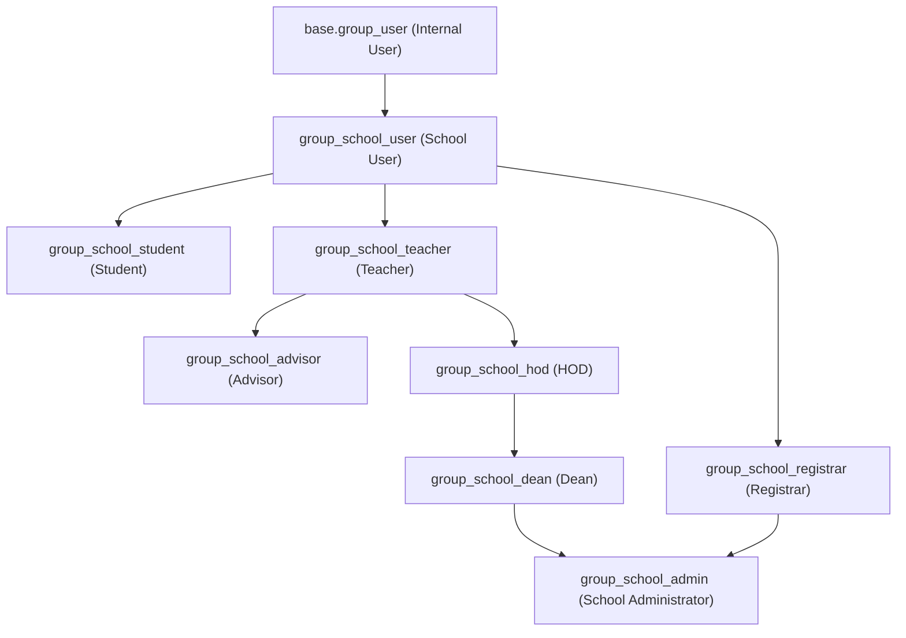

# University Management System Addon: Technical Overview

This document summarizes the custom `school_management` addon for Odoo 19. It reflects the refactored architecture that consolidates the system into a single cohesive module, fixes historical access/linkage issues, and establishes clean role-based dashboards.

## Documentation index

The module documentation set is organized under [`document/README.md`](./README.md). Use it as the entry point before reading the detailed design notes and feature specifications in this folder.

## Core Domain Models

- **Academic Structure**: `university.faculty` (head/dean, code, departments) -> `university.department` (head, faculty) -> `university.program` (degree type, duration, total credits, department) -> `university.subject` (code, credits, department).
- **Academic Calendar**: `university.academic.year` (code, current, date range, semesters) and `university.semester` (academic year, semester type, start/end dates).
- **People**:
  - `university.teacher`: HR-independent staff record with employee ID, user link (`res.users.teacher_id`), qualification, gender, active/inactive.
  - `university.student`: student ID (unique index), user link (`res.users.student_id`), status (draft/admitted/active/probation/graduated/suspended/withdrawn), academic placement (faculty, department, program, year, semester), GPA, completed credits, attendance rate, and emergency contact details.
  - `university.academic.assignment`: tracks teachers serving as Dean, HOD, Advisor, or Coordinator with active date ranges.
- **Operations**:
  - `university.classroom`: room number, building, capacity, facilities, active state.
  - `university.class.section`: subject, academic year, semester, teacher, room, capacity, status, slot count.
  - `university.class.schedule.line` & `university.timetable.slot`: recurring weekly lines and concrete timetable slots (day of week, start/end times).
  - `university.enrollment`: student enrollments into sections, tracking status (draft/enrolled/dropped/completed) and final grades.
  - `university.attendance`: per-session student attendance (present, late, absent, excused).
  - `university.assignment` & `university.assignment.submission`: coursework tracking, max scores, and submissions.
  - `university.lesson.plan`: syllabus/curriculum delivery tracking per class section.
  - `university.notice.board`: campus bulletins with urgency tags and audience targeting.
  - `university.service.hour`: extracurricular community service hour tracking.
- **Grading & Transcripts**:
  - `university.grading.scale`: GPA scales (4.0 standard, percentage boundaries, grade points).
  - `university.assessment.result`: continuous assessment and exam grade entries.
  - `university.report.card` & `university.transcript`: semester evaluations, cumulative GPA, and printed transcript records.
- **Finance**:
  - `university.fee`: student billing/invoice with line items and balance due.
  - `university.payment`: student payments against invoices.

## Security Roles & Group Hierarchy

All roles inherit through `school_management_privilege`:



Key access concepts:

- `group_school_user` provides baseline read access to academic lookups (faculties, departments, programs, subjects, classrooms).
- `group_school_student` is isolated: users only see their own `university.student` profile, enrollments, attendance, assignments, and grades.
- `group_school_teacher` accesses class sections, attendance sheets, and students assigned to them.
- `group_school_hod` scopes to their department (teachers, students, sections, subjects).
- `group_school_dean` scopes to their faculty and child departments.
- `group_school_registrar` manages enrollments, academic records, and student lifecycle.
- `group_school_admin` has full operational access.

## Data Integrity & Constraints

- `university.student` enforces `_sql_constraints` on unique `student_id`.
- Teacher records link to `res.users` through `res.users.teacher_id`; a migration and data fix (`fix_user_teacher_links.xml`) link the demo teacher accounts cleanly.
- `academic_assignment` uniqueness: only one active Dean per faculty and one active HOD per department.
- On student creation:
  - `student_id` auto-generates if omitted (`ir.sequence`: `seq.university.student`).
  - academic placement (department/faculty) derives from the selected program

## Dashboard

The addon ships three OWL dashboard shells under `static/src/school_management/`:

- **Operational dashboard** (`school.dashboard` + `dashboard_shell`) — KPI counts and finance totals with actions that open the corresponding models.
- **Student dashboard shell** ([`student_dashboard_shell.js`](file:///C:/Odoo/odoo/custom/school_management/static/src/school_management/student_dashboard_shell.js), complete guide: [student_dashboard_shell.md](file:///C:/Odoo/odoo/custom/school_management/document/student_dashboard_shell.md)) — the student-facing interactive start screen featuring Chart.js attendance charts, weekly schedule matrix, course cards, absence excuse submissions, and staff preview mode.
- **Teacher dashboard shell** (`teacher_dashboard_shell`) — teacher/advisor-focused attendance, class, and follow-up information.

The custom `layout/school_layout.js` wraps the sidebar, while the main Dashboard routes each of the six roles to the data and quick actions appropriate to its scope. The backend also patches the webclient topbar/sidebar via `layout/webclient_patch.js`.

## Reports

The manifest loads these report files:

- `reports/payment_report_template.xml` and `reports/payment_report.xml` — payment receipt.
- `reports/curriculum_report_template.xml` and `reports/curriculum_report.xml` — curriculum report.
- `reports/academic_report_templates.xml` and `reports/academic_reports.xml` — academic reports (report card / transcript).

The payment receipt action is `school_management.action_report_university_payment_receipt`.

## Menu and UI Areas

Main areas:

- University root menu with a single **Dashboard**, Structure, Students, Teachers, Academic, Enrollment, Finance, Grading, Attendance, and the teacher-portal menus (Lesson Plans, Assignments, Timetables, Notice Board, Service Hours).
- The single Dashboard is role-aware: students receive their personal dashboard; teachers/advisors receive their teaching dashboard; HOD, Head of Faculty, Registrar, and University Administrator receive their respective operational views. There is no duplicate backend Student Portal menu.
- A separate student **portal** flow is scaffolded: `views/portal_templates.xml` is currently a placeholder for portal pages, and `group_student_portal` (implies `base.group_portal`) grants read-only access to the student's own records.

## Migrations

- `migrations/19.0.1.2.0/pre-migrate.py`
- `migrations/19.0.1.2.1/pre-migrate.py` — repairs student academic placement to match their program, clears stale dean/head assignments, and de-duplicates student IDs before the new unique index is enforced.

Upgrade with `-u school_management` so the pre-migrations and `data/fix_user_teacher_links.xml` run.

## Current Status by Area

- Structure: implemented
- Teacher/student master data: implemented
- Admission applications: implemented
- Academic year and semester: implemented
- Class sections and classrooms: implemented
- Timetables: implemented (timeslots + timetable slots)
- Enrollment: implemented with wizard support
- Lesson plans, assignments/submissions, attendance, notice board, service hours: implemented
- Grading, assessment results, report cards, transcripts: implemented
- Finance: implemented as lightweight fee/payment flow with fee structures
- Dashboard: implemented with KPIs and role-specific shells
- Security roles and record scoping: implemented
- Student portal pages (`views/portal_templates.xml`): placeholder — planned
- Schedule conflicts, scholarships, graduation, certificates: planned

## Dean Access Rule

The intended dean scope is faculty-level management. A Dean user is linked to a teacher record through `res.users.teacher_id`, and the faculty points to that same teacher through `faculty.dean_id` (derived from active academic assignments).

Current implemented Dean access:

- Departments where `faculty_id.dean_id.user_id = user.id`
- Programs/majors where `department_id.faculty_id.dean_id.user_id = user.id`
- Subjects where `department_id.faculty_id.dean_id.user_id = user.id`
- Teachers where `department_id.faculty_id.dean_id.user_id = user.id`
- Students where `department_id.faculty_id.dean_id.user_id = user.id`

## Class Section & Assignment Integration

Class Section form view (`views/class_section_views.xml`) includes an embedded `assignment_ids` list under the **Assignment Type** tab. To ensure seamless creation of assignments directly from class sections:
- The view supplies `context="{'default_teacher_id': teacher_id, 'default_section_id': id, 'default_subject_id': subject_id}"`, auto-inheriting the section's teacher, section ID, and subject.
- A model-level safety net in `models/assignment.py` (`@api.model_create_multi def create`) ensures that if `teacher_id` ("Prepared By") is omitted on creation, it is auto-populated from the section's teacher.
- If the section has no teacher assigned, an explicit `ValidationError` is raised: *"Please set a Teacher on the class before adding assignments."*
- Comodel mappings between `section.teacher_id` and `assignment.teacher_id` (such as `university.teacher` vs `res.users`) are resolved safely.
- This prevents form validation failures when triggering header buttons (*View Interactive Schedule*, *SCHEDULE TIMETABLE*, *Populate Class*).
- A standalone maintenance script is provided at `scripts/fix_empty_assignment_teachers.py` to audit and backfill any historical assignments missing a teacher.

## Verification Notes

As of 2026-09-10:

- The module upgrades successfully with `-u school_management` (version `19.0.1.2.1`).
- Focused payment tests exist in `tests/test_payment.py`.
- The user ↔ teacher link data-integrity fix is defined in `data/fix_user_teacher_links.xml` (see also `security/fix_demo_staff_links.sql`).

## File Map

```text
school_management/
|-- __manifest__.py
|-- __init__.py
|-- README.md                         # Module root README documenting Student Dashboard Shell
|-- models/
|   |-- __init__.py
|   |-- academic_assignment.py
|   |-- academic_year.py
|   |-- admission.py
|   |-- assignment.py
|   |-- attendance.py
|   |-- capability.py
|   |-- classroom.py
|   |-- class_section.py
|   |-- dashboard.py
|   |-- department.py
|   |-- document_signature.py
|   |-- enrollment.py
|   |-- faculty.py
|   |-- fee.py
|   |-- grading.py
|   |-- lesson_plan.py
|   |-- notice_board.py
|   |-- payment.py
|   |-- program.py
|   |-- res_config_settings.py
|   |-- res_users.py
|   |-- semester_subject.py
|   |-- service_hour.py
|   |-- student.py
|   |-- subject.py
|   |-- teacher.py
|   `-- timetable.py
|-- security/
|   |-- security.xml
|   |-- ir.model.access.csv
|   |-- record_rules.xml
|   `-- fix_demo_staff_links.sql      (reference only, not loaded by Odoo)
|-- data/
|   |-- cleanup_legacy_models.xml
|   |-- dashboard_data.xml
|   |-- fee_sequence.xml
|   |-- academic_defaults.xml
|   |-- mail_template.xml
|   |-- university_capability_data.xml
|   `-- fix_user_teacher_links.xml
|-- migrations/
|   |-- 19.0.1.2.0/pre-migrate.py
|   `-- 19.0.1.2.1/pre-migrate.py
|-- wizard/
|   |-- bulk_enrollment_wizard.py + views
|   |-- student_enrollment_wizard.py + views
|   |-- populate_class_wizard.py + views
|   |-- timetable_generation_wizard.py + views
|   `-- teacher_account_wizard.py + views
|-- reports/
|   |-- payment_report_template.xml / payment_report.xml
|   |-- curriculum_report_template.xml / curriculum_report.xml
|   `-- academic_report_templates.xml / academic_reports.xml
|-- views/
|   |-- (faculty, department, program, subject, classroom, class_section,
|   |--  academic_year, semester_subject, academic_assignment, teacher,
|   |--  student, enrollment, fee, payment, admission, capability, grading,
|   |--  lesson_plan, assignment, timetable, notice_board, service_hour,
|   |--  document_signature, dashboard, teacher_dashboard_shell_actions,
|   |--  school_dashboard_shell_actions, res_config_settings, menu_views,
|   |--  portal_templates — placeholder)
|-- static/
|   `-- src/school_management/
|       |-- README.md                 # Frontend assets README
|       |-- backend.scss
|       |-- dashboard_shell.{js,xml,scss}
|       |-- student_dashboard_shell.{js,xml,scss}
|       |-- teacher_dashboard_shell.{js,xml,scss}
|       `-- layout/school_layout.{js,xml,scss} + webclient_patch.{js,xml} + topbar_integration.scss
|-- scripts/
|   |-- audit_semester_subject_duplicates.py
|   |-- cleanup_student_data.py
|   |-- cleanup_teacher_data.py
|   `-- fix_empty_assignment_teachers.py
|-- tests/
|   |-- __init__.py
|   `-- test_payment.py
|-- seed/
|   |-- run_seed.py
|   `-- seed_data.sql
`-- document/
    |-- README.md
    |-- student_dashboard_shell.md    # Dedicated technical manual for student_dashboard_shell.js
    |-- student_role_features.md      # Student security, permissions, and features
    |-- project_overview.md
    |-- project_structure.md.md
    |-- agent_guide.md
    |-- local_configuration_guide.md
    |-- login_guide.md
    |-- university_management_system_architecture.md
    `-- SCHOOL_MANAGEMENT_QNA_REVIEW_9b9dd9a6.md
```
