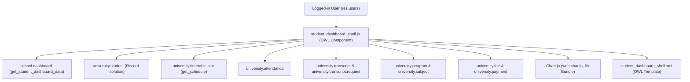
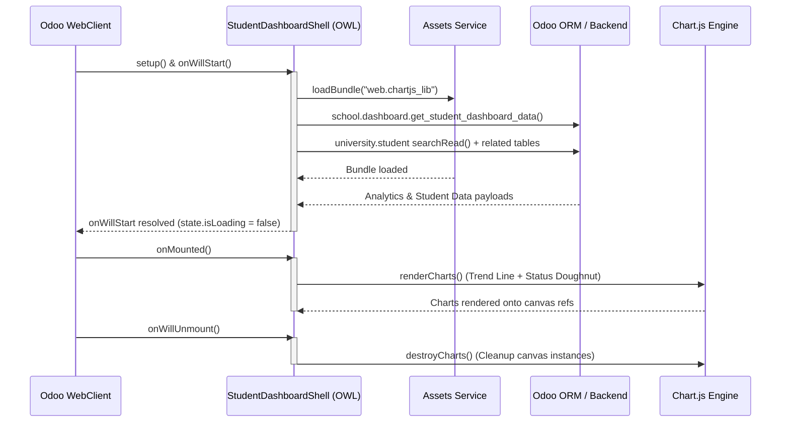
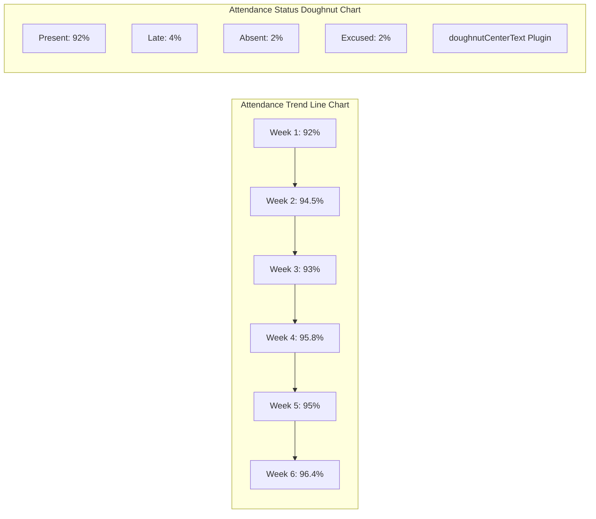
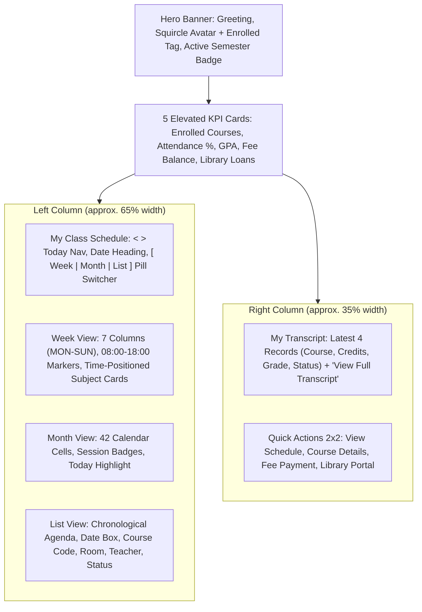
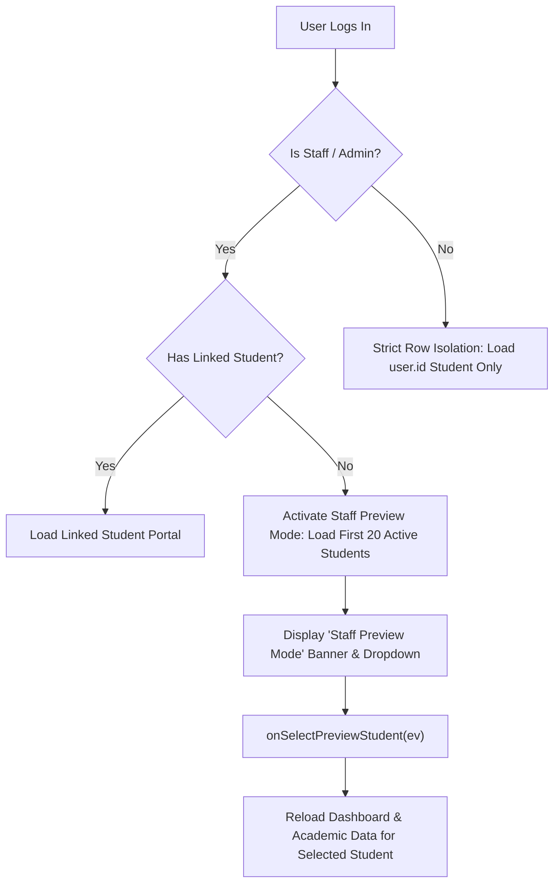

# Student Dashboard Shell (`student_dashboard_shell.js`) — Technical & Functional Guide

**File Location:** [student_dashboard_shell.js](file:///C:/Odoo/odoo/custom/school_management/static/src/school_management/student_dashboard_shell.js)  
**Companion Template:** [student_dashboard_shell.xml](file:///C:/Odoo/odoo/custom/school_management/static/src/school_management/student_dashboard_shell.xml)  
**Companion Stylesheet:** [student_dashboard_shell.scss](file:///C:/Odoo/odoo/custom/school_management/static/src/school_management/student_dashboard_shell.scss)  
**Action Identifier:** `student_dashboard_shell` (`school_management.action_student_dashboard_shell`)  
**Technology Framework:** Odoo 19.0 / OWL 2 (Odoo Web Library) / Chart.js / Luxon DateTime  

---

## 1. Executive Summary

`student_dashboard_shell.js` is the primary frontend JavaScript controller powering the **Student Academic Portal** single-page application (SPA) in the Odoo 19 School Management system. It implements an interactive, reactive OWL 2 `Component` that acts as the student's primary digital campus hub.

The controller integrates real-time academic records, timetable scheduling, attendance tracking, transcript requests, curriculum compliance, campus announcements, and tuition summaries into a unified interface. It also includes an administrative **Staff Preview Mode**, allowing teachers, registrars, and school administrators to view and test the student experience on behalf of any enrolled student.



---

## 2. Architecture & Imports

The component is registered in the Odoo action registry category `"actions"` under the technical key `student_dashboard_shell`:

```javascript
import { Component, onWillStart, onMounted, onWillUnmount, useRef, useState } from "@odoo/owl";
import { loadBundle } from "@web/core/assets";
import { user } from "@web/core/user";
import { registry } from "@web/core/registry";
import { useService } from "@web/core/utils/hooks";

// Component Registration
registry.category("actions").add("student_dashboard_shell", StudentDashboardShell);
```

### 2.1 Injected Core Services (`useService`)
In the `setup()` method, the component initializes standard Odoo Web Client services:
- **`this.orm` (`useService("orm")`)**: Executes backend RPC calls (`searchRead`, `searchCount`, `call`).
- **`this.action` (`useService("action")`)**: Dispatches standard Odoo window actions (`doAction`), reports (`ir.actions.report`), and dialogs.
- **`this.notification` (`useService("notification")`)**: Triggers user-facing toast alerts (`success`, `warning`, `info`).

### 2.2 Template & DOM Binding
- **Template Binding:** `static template = "school_management.StudentDashboardShell";`
- **Props Acceptance:** `static props = ["*"];`
- **Canvas Refs:**
  - `this.chartTrendRef = useRef("chart_attendance_trend");` (Line chart canvas)
  - `this.chartStatusRef = useRef("chart_attendance_status");` (Doughnut chart canvas)

---

## 3. Component Lifecycle Management

The controller defines a structured lifecycle to manage concurrent data fetching, Chart.js initialization, and memory cleanup:



1. **`setup()`**:
   - Initializes reactive state via `useState()`.
   - Reads context parameters (`actionContext.student_initial_tab`) to allow deep-linking directly into tabs such as `schedule`, `attendance`, `transcript`, or `financial`.
   - Restores persisted user preferences from `localStorage`:
     - `student_schedule_view_mode`: `'agenda'` or `'week'`.
     - `student_sidebar_collapsed`: `'1'` or `'0'`.

2. **`onWillStart()`**:
   - Inspects user group permissions via `user.hasGroup(...)` to establish whether the current session has staff privileges (`canSwitchRoles`).
   - Concurrently executes `loadBundle("web.chartjs_lib")`, `this.loadDashboardData()`, and `this.loadStudentData()`.
   - Sets `state.isLoading = false` in the `finally` block to transition out of the loading skeleton.

3. **`onMounted()`**:
   - Invokes `this.renderCharts()` if `state.activeTab === "dashboard"` and chart canvas DOM references are available.

4. **`onWillUnmount()`**:
   - Executes `this.destroyCharts()` to iterate through all active Chart.js instances and call `.destroy()`, preventing memory leaks and orphaned event listeners.

---

## 4. Reactive State Reference (`this.state`)

The component manages all UI data and state via OWL's `useState`:

| State Field | Type | Default Value | Description |
| :--- | :--- | :--- | :--- |
| `loading` | `boolean` | `true` | Indicates student record and related relational data loading. |
| `isLoading` | `boolean` | `true` | Indicates dashboard summary metrics and chart data loading. |
| `isRefreshing` | `boolean` | `false` | Set during manual data reloads (`reload()`) for button spin animations. |
| `error` | `string \| null` | `null` | Holds human-readable error descriptions if RPC requests fail. |
| `student` | `object \| null` | `null` | The active `university.student` dictionary. |
| `isPreviewMode` | `boolean` | `false` | True when a staff/admin user is previewing another student's portal. |
| `previewStudents` | `Array<object>` | `[]` | List of students available for staff preview switching. |
| `selectedPreviewStudentId` | `number \| null` | `null` | Selected student ID when preview mode is active. |
| `activeTab` | `string` | `'dashboard'` | Current active view: `dashboard`, `classes`, `schedule`, `attendance`, `transcript`, `curriculum`, `financial`, `notices`. |
| `dashboard` | `object` | `{}` | Key metrics returned by `school.dashboard.get_student_dashboard_data`. |
| `chartData` | `object` | `{}` | Attendance trend and doughnut metrics payload from backend. |
| `filters` | `object` | `{ yearId: false, semesterId: false }` | Active academic year and semester filter IDs. |
| `filterOptions` | `object` | `{ academicYears: [], semesters: [] }` | Available academic year and semester choices. |
| `enrolledClasses` | `Array<object>` | `[]` | Assembled array of enrolled class sections with instructor and room metadata. |
| `scheduleSlots` | `Array<object>` | `[]` | Active week timetable sessions from `university.timetable.slot.get_schedule`. |
| `scheduleViewMode` | `string` | `'agenda'` or `'week'` | Schedule visualization mode. |
| `currentWeekOffset` | `number` | `0` | Week offset relative to today (0 = current week, -1 = last week, +1 = next week). |
| `selectedDayOffset` | `number` | `1` | Day offset for day picker strip (0 = Mon, 1 = Tue, ..., 4 = Fri). |
| `selectedDayDateStr` | `string \| null` | `null` | Selected calendar date string in `YYYY-MM-DD` format. |
| `attendanceStats` | `object` | `{ rate: 100, present: 0, late: 0, absent: 0, excused: 0, ... }` | Aggregated attendance statistics, course breakdown, and recent logs. |
| `notices` | `Array<object>` | `[]` | Broadcast campus announcements from `university.notice.board`. |
| `selectedNotice` | `object \| null` | `null` | Active announcement opened in modal reader. |
| `transcripts` | `Array<object>` | `[]` | Student official transcript record. |
| `transcriptLines` | `Array<object>` | `[]` | Historical course grades and grade points. |
| `transcriptRequests` | `Array<object>` | `[]` | Pending and approved official transcript requests. |
| `programInfo` | `object \| null` | `null` | Degree program metadata (`university.program`). |
| `programSubjects` | `Array<object>` | `[]` | Curriculum subjects marked as `completed`, `enrolled`, or `required`. |
| `modalType` | `string \| null` | `null` | Active modal dialog: `'syllabus'`, `'attendance'`, `'excuse'`, or `null`. |
| `selectedCourseModal` | `object \| null` | `null` | Enrolled class object passed to modal. |
| `excuseData` | `object` | `{ sectionId: null, date: '', reason: 'medical', notes: '' }` | Form state for submitting absence excuse requests. |
| `sidebarCollapsed` | `boolean` | `false` | Toggles left navigation sidebar collapse state. |
| `showProfileMenu` | `boolean` | `false` | Toggles top-right student profile dropdown. |
| `canSwitchRoles` | `boolean` | `false` | True if the current user belongs to academic staff or administration groups. |

---

## 5. Backend RPC & Data Ingestion Methods

### 5.1 `loadDashboardData(targetStudentId = null)`
- Calls `school.dashboard` -> `get_student_dashboard_data`.
- Arguments: `year_id`, `semester_id`, and `student_id`.
- Populates `this.state.dashboard`, `this.state.chartData`, and updates active filter defaults.

### 5.2 `loadStudentData(targetStudentId = null)`
This is the core data aggregation method:
1. **Student Record Resolution:**
   - If `targetStudentId` is provided, fetches the specified student profile.
   - Otherwise, executes `searchRead("university.student", [["user_id", "=", user.userId]])`.
   - **Preview Fallback:** If no linked student is found and the user is an admin or teacher, automatically retrieves up to 20 active students and activates Staff Preview Mode.
2. **Class Sections & Classroom Resolution:**
   - Reads `university.enrollment` for the student.
   - Extracts `section_ids` and loads `university.class.section` records with classroom IDs.
   - Loads `university.classroom` details (building, room type, capacity) and `university.subject` data (course codes, credits).
3. **Attendance Compilation:**
   - Reads `university.attendance` logs (`present`, `late`, `absent`, `excused`).
   - Computes overall attendance rate: $\text{Rate} = \left(\frac{\text{Present}}{\text{Total}}\right) \times 100$.
   - Flags course risk if rate $< 80\%$ with $\ge 3$ sessions.
4. **Schedule Timetable Ingestion:**
   - Calculates the Monday to Sunday date boundaries for the active week.
   - Calls `university.timetable.slot.get_schedule(startStr, endStr, { academic_year_id, semester_id })`.
   - Enhances each slot with date/time formatting via `parseSlotTimes()`, status metadata via `getSlotStatusMeta()`, and subject color badges via `getSubjectColorClass()`.
5. **Transcripts & Curriculum:**
   - Queries `university.transcript` and `university.transcript.line`. Falls back to `university.report.card` if no transcript exists.
   - Cross-references program subjects with completed and enrolled courses to classify curriculum status (`completed`, `enrolled`, `required`).
6. **Defensive Financial Scoping:**
   - Queries `university.fee`, `university.payment`, and `university.student.followup`.
   - Wrapped in dedicated `try / catch` blocks so that strict security record rules on financial models do not block academic portal functionality.

---

## 6. Chart.js Visualizations & Plugins

The component renders two Chart.js visual analytics components using `web.chartjs_lib`:



### 6.1 Custom Inline Plugin: `doughnutCenterText`
Located at lines 10–36 of [student_dashboard_shell.js](file:///C:/Odoo/odoo/custom/school_management/static/src/school_management/student_dashboard_shell.js#L10-L36):
- Hook: `afterDraw(chart)`
- Reads `chart.options.plugins.centerText`.
- Calculates canvas center coordinates: $X = \frac{\text{left} + \text{right}}{2}$, $Y = \frac{\text{top} + \text{bottom}}{2}$.
- Draws custom central text (e.g., `"92% Present"`) in bold 18px font with subtitle label.

### 6.2 Weekly Attendance Trend (Line Chart)
- **Canvas Reference:** `this.chartTrendRef` (`chart_attendance_trend`).
- **Visual Style:** Smooth cubic Bézier spline (`tension: 0.4`), `#4f46e5` border, vertical linear gradient fill (`rgba(79, 70, 229, 0.20)` to `rgba(79, 70, 229, 0.0)`).
- **Y-Axis Bounds:** Constrained between 50% and 100% with percentage tick callbacks.

### 6.3 Attendance Status (Doughnut Chart)
- **Canvas Reference:** `this.chartStatusRef` (`chart_attendance_status`).
- **Cutout:** `75%` inner radius creating a modern, thin donut ring.
- **Color Palette:**
  - Present: `#10b981` (Emerald Green)
  - Late: `#f59e0b` (Amber Orange)
  - Absent: `#ef4444` (Rose Red)
  - Excused: `#3b82f6` (Sapphire Blue)

---

## 7. Computed Getters & Business Logic

### 7.1 Time-Sensitive Greeting & Academic Standing
- **`greeting`**: Dynamically evaluates local hour:
  - $< 12$: `"Good morning, {FirstName}"`
  - $12 \le \text{hour} < 17$: `"Good afternoon, {FirstName}"`
  - $\ge 17$: `"Good evening, {FirstName}"`
- **`studentStandingBadge`**:
  - $\text{GPA} \ge 3.8$: **First Class Honors** (`bg-warning-subtle text-warning`)
  - $\text{GPA} \ge 3.5$: **Dean's List** (`bg-success-subtle text-success`)
  - $\text{GPA} \ge 2.0$: **Good Standing** (`bg-info-subtle text-info`)
  - $\text{GPA} < 2.0$: **Academic Advisory** (`bg-danger-subtle text-danger`)

### 7.2 Timetable & Next Class Countdown
- **`nextClassThisWeek`**:
  - Scans active week sessions for any slot currently `"live"`. If found, displays badge `"Live Now"`.
  - Otherwise, finds the earliest upcoming session and calculates the time difference in milliseconds:
    - $< 60$ minutes: `"Starts in X min"`
    - $< 24$ hours: `"Starts in X hrs"`
    - $1$ day: `"Starts in 1 day"`
    - $> 1$ day: `"Starts in X days"`

### 7.3 Course Risk & Attendance Badge Evaluation
- **`getCourseAttendanceMeta(cls)`**:
  - Attendance $< 70\%$: Status `"At risk"`, progress color `#ef4444`.
  - Attendance $70\% - 74\%$: Status `"Watch"`, progress color `#d97706`.
  - Attendance $\ge 75\%$: Status `"Enrolled"`, progress color `#0d9488`.

### 7.4 Deterministic Color Assignment
- **`getSubjectColorClass(code)`**:
  - Hashes the course code string with polynomial rolling hash:
    $$\text{hash} = \sum_{i=0}^{n-1} \left(\text{code}[i] \times 31^{n-1-i}\right)$$
  - Maps to 6 color palettes: `sapphire`, `emerald`, `indigo`, `amber`, `teal`, `rose`.

---

## 8. User Interaction & Modal Actions

### 8.1 Tab Navigation
- `setActiveTab(tab)`: Transitions views between `dashboard`, `classes`, `schedule`, `attendance`, `transcript`, `curriculum`, `financial`, `notices`.
- Cleans up and re-triggers chart rendering when returning to `dashboard`.

### 8.2 Modal Dialogs
1. **Course Syllabus Modal (`openSyllabusModal`)**:
   - Opens modal showing course code, credits, instructor, room, learning objectives, and grading weights.
   - Includes direct button `"Open Official Record"` dispatching `university.subject` form.
2. **Course Attendance Modal (`openCourseAttendanceModal`)**:
   - Displays course attendance rate, exam eligibility status ($80\%$ rule), and recent session attendance logs.
3. **Absence Excuse Submission Modal (`openExcuseModal`, `submitExcuse`)**:
   - Allows students to select class section, date of absence, reason category (`medical`, `family`, `official`, `other`), and enter explanatory notes.
4. **Campus Announcement Reader Modal (`openNoticeModal`, `closeNoticeModal`)**:
   - Opens high-priority announcement modal displaying rich HTML announcement content.

### 8.3 Document Generation & CSV Export
- **CSV Roster Export (`downloadClassesList()`)**:
  - Compiles enrolled classes into RFC-4180 compliant CSV text.
  - Automatically triggers client download: `My_Classes_{StudentID}.csv`.
- **Curriculum PDF (`printCurriculum()`)**:
  - Calls `action.doAction` with QWeb report `school_management.report_curriculum_document`.
- **Official Transcript PDF (`printTranscript()`)**:
  - Calls `action.doAction` with QWeb report `school_management.report_university_transcript_document`.

### 8.5 Modern University Student Portal Redesign (RUPP Reference Layout)

The main student dashboard view implements a modern, responsive two-column university portal:



#### Core Components & Technical Behavior:
1. **Top Section**:
   - **Hero Welcome Banner**: Personalized greeting (`"Good morning/afternoon, [Name] 👋"`), squircle student avatar with `Enrolled [X]` badge, and active semester pill (`Semester [X] · [Year]`).
   - **5 Elevated KPI Cards**:
     - *Enrolled Courses*: Count of active enrollments with primary semester info.
     - *Attendance Rate*: Percentage with status indicator (Good Standing / Warning).
     - *Cumulative GPA*: Current GPA with Dean's List / Honors badge.
     - *Fee Balance*: Outstanding balance with `"Paid in Full"` or payment status.
     - *Library Loans*: Current active book loans with due date warning badge.

2. **Left Column (~65% width) — My Class Schedule**:
   - **Period Navigation**: `<` (Previous), `>` (Next), and `Today` buttons dynamically shift week or month offsets.
   - **Dynamic Date Heading**: Automatically updates based on view mode (e.g. `Nov 2 – 8, 2026` or `November 2026`).
   - **Pill View Switcher**: `[ Week | Month | List ]` styled with `#7c3aed` active purple pill theme.
   - **Week View**:
     - 7 column layout from Monday to Sunday.
     - Time gutter from `08:00` to `18:00` with horizontal guideline grid.
     - Timetable event cards positioned via `getSlotPositionStyle(slot)` using exact start and end minute offsets.
     - Distinct subject palette classes (`o_slot_palette_purple`, `o_slot_palette_sapphire`, etc.) based on course hash.
   - **Month View**:
     - 7-day grid showing full month with previous/next month leading/trailing days muted.
     - Daily session count badges (e.g. `1 session`, `2 sessions`) with click-to-calendar action.
   - **List View**:
     - Chronological agenda list with structured date box, course code badge, title, room, instructor, and session status badge.

3. **Right Column (~35% width) — Transcript & Quick Actions**:
   - **My Transcript Table**:
     - Displays the latest four completed/in-progress course results from `university.transcript.line`.
     - Columns: Course (Code & Title), Credits, Grade, Status badge (`Passed`, `Failed`, `In Progress`).
     - `"View Full Transcript →"` opens complete official transcript records.
   - **Quick Actions (2x2 Grid)**:
     - *View Schedule*: Opens university timetable calendar.
     - *Course Details*: Opens class section and syllabus viewer.
     - *Fee Payment*: Opens fee invoices and payment receipts.
     - *Library Portal*: Opens university service requests / library catalog.

4. **Security & Data Isolation**:
   - Strictly derived from authenticated `env.user.id`. No frontend student ID spoofing permitted.
   - Database queries filter by enrolled sections and date bounds directly through Odoo ORM.

### 8.4 Self-Service Odoo Window Action Dispatchers
- **`openMyClasses()`**: Sets active tab to `'classes'`.
- **`openAttendance()`**: Dispatches `school_management.action_university_attendance_student`.
- **`openMyTimetableCalendar()`**: Dispatches `school_management.action_university_timetable_slot_student` (forcing week view in `localStorage`).
- **`openMyProfile()`**: Opens `university.student` form view in read-only self-view mode.
- **`openNewTranscriptRequest()`**: Launches transcript request dialog (`university.transcript.request`) with modal `onClose` reload callback.
- **`openMyInvoices()` & `openMyPayments()`**: Launches student fee invoices and payment receipts.
- **`openFeePaymentWizard()`**: Opens online tuition payment wizard dialog (`university.fee.payment.wizard`).

---

## 9. Security, Scoping & Staff Preview Mode



1. **Record-Level Data Isolation:**
   - Non-staff student logins are strictly scoped to records where `user_id == user.userId`.
   - Actions opened by the shell enforce `create: false`, `edit: false`, `delete: false` in contexts.
2. **Staff Preview Mode:**
   - Teachers (`group_school_teacher`), Registrars (`group_school_registrar`), and Admins (`group_school_admin`, `base.group_system`) who do not have an associated student record can browse any student's portal.
   - An interactive banner displays: `"Staff Preview Mode: Viewing Student Academic Portal for [Student Name]"`.
   - The dropdown invokes `onSelectPreviewStudent(ev)` to immediately reload all data for the selected student.

---

## 10. Companion Files & Cross-References

| File Path | Description |
| :--- | :--- |
| [student_dashboard_shell.xml](file:///C:/Odoo/odoo/custom/school_management/static/src/school_management/student_dashboard_shell.xml) | QWeb XML template rendering identity header, tabs, metric cards, timetable strip, modals, and charts. |
| [student_dashboard_shell.scss](file:///C:/Odoo/odoo/custom/school_management/static/src/school_management/student_dashboard_shell.scss) | SCSS styling defining executive card themes, chart containers, badges, responsive grids, and print rules. |
| [dashboard.py](file:///C:/Odoo/odoo/custom/school_management/models/dashboard.py) | Backend model implementing `get_student_dashboard_data()` and `get_filter_options()`. |
| [student_role_features.md](file:///C:/Odoo/odoo/custom/school_management/document/student_role_features.md) | Comprehensive specification of student capabilities, record rules, and permissions matrix. |
| [project_overview.md](file:///C:/Odoo/odoo/custom/school_management/document/project_overview.md) | High-level system architecture and module overview. |

---

## 11. Developer Extension & Troubleshooting Guide

### 11.1 Adding a New Metric or Tab
To introduce a new portal tab (e.g., `'internships'`):
1. Add the tab key to the allowed list in `setup()`:
   ```javascript
   const initialTab = ["dashboard", "classes", "schedule", "attendance", "transcript", "curriculum", "financial", "notices", "internships"]
   ```
2. Define the sidebar navigation item in `studentSidebarGroups`:
   ```javascript
   { id: "internships", label: "Internships", iconSvg: "briefcase", isActive: this.state.activeTab === "internships" }
   ```
3. Add the title mapping in `activeTabTitle`.
4. In [student_dashboard_shell.xml](file:///C:/Odoo/odoo/custom/school_management/static/src/school_management/student_dashboard_shell.xml), add `<t t-if="state.activeTab === 'internships'"> ... </t>`.

### 11.2 Common Issues & Resolutions
- **Chart does not appear on initial load:**
  - Verify that `loadBundle("web.chartjs_lib")` has resolved in `onWillStart`.
  - Ensure canvas elements use `t-ref="chart_attendance_trend"` and `t-ref="chart_attendance_status"`.
- **Date/Time formatting displays invalid:**
  - Check that `globalThis.luxon.DateTime` is available. `parseSlotTimes` uses Luxon with SQL parsing in UTC timezone converted to local time.
- **Financial metrics show empty:**
  - Standard student security groups restrict direct read access to fee configurations. The component handles this via fallback defaults to ensure the rest of the portal functions smoothly.
