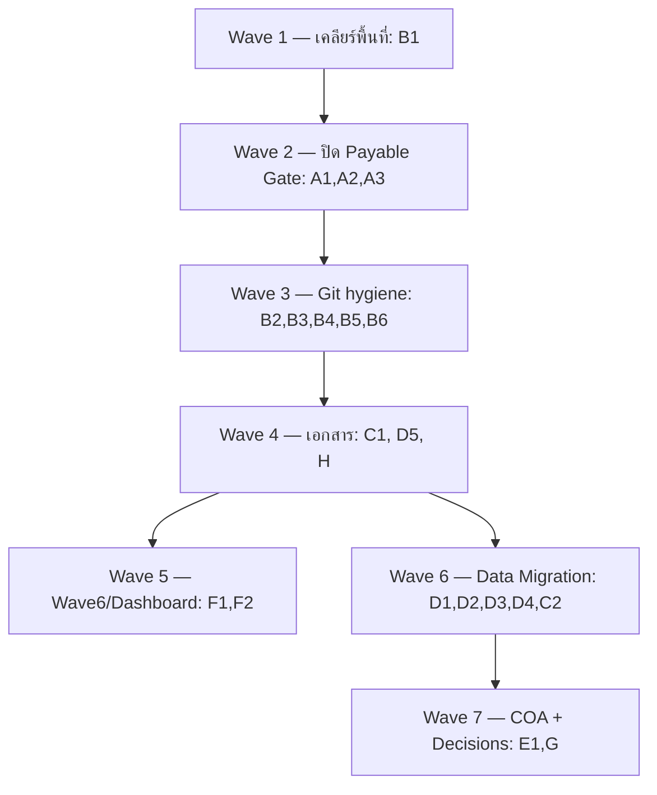

# Odoo 19 Backlog Closure Plan — แผนปิดงานค้างทั้งหมด

> **For agentic workers:** REQUIRED SUB-SKILL: ใช้ `superpowers:subagent-driven-development` หรือ `superpowers:executing-plans` เพื่อทำตามแผนนี้ทีละ Task โดยใช้ checkbox (`- [ ]`) ในการติดตามความคืบหน้า ทุก Task ต้องมี "หลักฐานปิดงาน" ก่อนติ๊ก

**Goal:** ปิดงานค้าง **ทั้งหมด** ของโครงการ Odoo 19 CE (ที่เหลือ ณ 2026-11-01) ให้สถานะเอกสารตรงกับงานจริง 100% และส่งมอบ release แรกที่พร้อมใช้งาน

**Architecture (หลักการดำเนินงาน):**
1. **ยืนยันจากของจริงก่อนแก้เอกสารเสมอ** — หลักฐาน 3 แหล่ง: ซอร์สโค้ด (`custom_addons/`), git (commit/branch), และ `ir_module_module` state ใน DB
2. **Atomic commit** — 1 commit = 1 เรื่อง; ใช้ Conventional Commits; ห้ามแก้ core `addons/` ในงานปกติ
3. **Feature branch** — prefix เดียว `feature/` ตาม [git-and-release-baseline.md](file:///c:/odoo-dev/odoo19/docs/superpowers/programs/odoo19-enterprise/foundation/git-and-release-baseline.md)
4. **Gate ห้ามผ่อนปรน** — ยอดยกมาต้อง tie กับ legacy 100%; ไม่มีการอนุมัติสินเชื่อ/จ่ายเงินโดยข้าม gate

**Tech Stack:** Odoo 19 CE, PostgreSQL (pg_dump/psql, staging DB), Python 3 (`venv19`, psycopg2, openpyxl), PowerShell (Windows), Git + LFS, OCA modules

**เอกสารอ้างอิงหลัก:**

| ประเภท | ไฟล์ |
|---|---|
| Master tracker | [domain-wave-matrix.md](file:///c:/odoo-dev/odoo19/docs/superpowers/programs/odoo19-enterprise/backlog/domain-wave-matrix.md) |
| Thai tax compliance | [thai-accounting-compliance-gap.md](file:///c:/odoo-dev/odoo19/docs/superpowers/programs/odoo19-enterprise/backlog/thai-accounting-compliance-gap.md) |
| Payable Control Gate | [2026-11-01-od19-payable-control-gate-design.md](file:///c:/odoo-dev/odoo19/docs/superpowers/specs/2026-11-01-od19-payable-control-gate-design.md) |
| Git baseline | [git-and-release-baseline.md](file:///c:/odoo-dev/odoo19/docs/superpowers/programs/odoo19-enterprise/foundation/git-and-release-baseline.md) |
| Data migration | [2026-10-22-odoo15-to-odoo19-data-migration-plan.md](file:///c:/odoo-dev/odoo19/docs/superpowers/plans/2026-10-22-odoo15-to-odoo19-data-migration-plan.md) |
| Wave 6 (Thai process gaps) | [TH_PROCESS_GAP_AND_WAVE6_PLAN_TH.md](file:///c:/odoo-dev/odoo19/TH_PROCESS_GAP_AND_WAVE6_PLAN_TH.md) |

---

## สถานะรวม (Baseline 2026-11-01)

| Epic | ขอบเขต | จำนวนงาน | Blocker | เริ่มได้ทันที |
|---|---|---|---|---|
| A | Payable Control Gate ปิดวง (T9–T10) | 3 | ไม่มี | ✅ |
| B | Git / Release hygiene | 7 | มีจุดตัดสินใจ (B1) | ✅ (บางส่วน) |
| C | เอกสาร discovery/checklist | 2 | C2 รอ D1 | ✅ (C1) |
| D | Data Migration OD15→OD19 | 5 | รอเลือก DB + สิทธิ์ | ⚠️ |
| E | COA Migration | 1 | รอผู้ใช้ยืนยัน mapping | ⏸ |
| F | Wave 6 / Dashboard | 2 | F1 รออนุมัติ | ⏸ |
| G | Open Decisions ฝ่ายบัญชี | 4 | รอบัญชี | ⏸ |
| H | เทคนิคยิบย่อย | 2 | ไม่มี | ✅ |

**หลักฐาน ณ วันจัดทำ:** branch `feat/od19-wave3-corporate-income-tax` (ยังไม่ merge เข้า `19.0`); working tree มี 4 ไฟล์ modified; P1-T8 ปิดแล้ว (commit `df6a6873495`)

**อัปเดต 2026-11-01 — ปิด Wave 1 / Task B1:** working tree สะอาด ✅ (commit `d4597c09cb5` เทสต์ `od19_hr_advance`, `7b6d2c7d209` search view ตาม Odoo 19, `7c31530e3dc` Summary Board First); P1-T9 ปิดแล้ว (commit `5fc3d68ffbe`); คงเหลือ defect นอกขอบเขต 1 รายการ (ดูหมายเหตุใน Task B1)

**อัปเดต 2026-11-02 — EPIC H + B4/B5 + C1/D5:** ปิดครบ 6 งาน — H1 (ไม่มี defect ค้าง), H2 (`stock_request_purchase` = `installed`), B4 (22 OCA submodules pin SHA ครบ), B5 (`.gitattributes` + Git LFS → commit `b80218bb4b4`), C1 (access-readiness ครบหลักฐาน → commit `3d47662b998`), D5 (precondition dump ใหม่ → commit `ee33dbf8602`); defect `276.0 != 138.0` ของ B1 ซ่อมแล้ว → commit `b120d0292ff`

---

## Execution Sequence

---

## EPIC A — Payable Control Gate Closure

> อ้างอิง: [Payable Control Gate Design](file:///c:/odoo-dev/odoo19/docs/superpowers/specs/2026-11-01-od19-payable-control-gate-design.md) — T1–T10 = done+verified 2026-11-01 (spec สถานะ Approved / Implemented)

### Task A1 — ปิด T9: เทสต์ TDD ครบเกณฑ์ + sync wave-2 spec (ปิดแล้ว 2026-11-01)
- [x] **Objective:** ทำให้เทสต์ P1 ครบเกณฑ์ทั้ง 9 ข้อ และ sync สถานะ spec ที่สองให้ตรง
- [x] **Evidence ที่ต้องมี:** ผลรัน `--test-enable` ของ `od19_purchase_procurement_core` + `od19_accounting_payment_voucher_reports` = `0 failed, 0 error`; ไฟล์ [wave-2 spec](file:///c:/odoo-dev/odoo19/docs/superpowers/specs/2026-10-21-odoo19-enterprise-wave-2-custom-finance-controls.md) อัปเดตหัวข้อ Payment Preparation
- [x] **Steps:**
  1. ตรวจ criteria 1–9 ใน spec T9 ว่าเทสต์ใดขาด
  2. เขียนเทสต์ที่ขาด (TDD) แล้วรันด้วย `$env:PYTHONDONTWRITEBYTECODE=1; python -B odoo-bin -d odoo19_pdev --test-enable --test-tags <tag>`
  3. อัปเดต wave-2 spec ให้ระบุว่า Payment Preparation ครอบด้วย `od19_require_vendor_bill_for_payment`
- [x] **Acceptance:** เทสต์ผ่านครบ, spec 2 ฉบับสถานะตรงกัน, commit `test(...)`
- [x] **Subagent:** `general_purpose_task`
- [x] **ปิดงาน (2026-11-01):** traceability §9.1 ครบเกณฑ์ 1–9, เทสต์ 67 ตัว `0 failed, 0 error(s)`; sync wave-2 spec §6.10 → commit `5fc3d68ffbe`

### Task A2 — ปิด T10: UAT จำลอง business flow (ปิดแล้ว 2026-11-01)
- [x] **Objective:** จำลอง flow บิลจาก PO → รับของ → ขอจ่าย → อนุมัติ → จ่ายครบทุกข้อบังคับ
- [x] **Evidence:** สคริปต์/บันทึกผล UAT ≥ 10 เคส + ผลเทียบกับ gate (`od19_require_vendor_bill_for_payment`, SoD, three-way match)
- [x] **Steps:** เตรียมข้อมูลตัวอย่าง (ประมาณ 10 รายการ/ส่วน) → รัน flow → บันทึกผล pass/fail → สรุปช่องว่าง
- [x] **Acceptance:** 10 เคสผ่าน หรือมี defect list + งานติดตาม
- [x] **Subagent:** `general_purpose_task`
- [x] **ปิดงาน (2026-11-01):** `TestPayableUatBusinessFlow` 13 เคส ผ่านทั้งหมด; รันบน DB `odoo19_uat` → `0 failed, 0 error(s) of 40 tests` (แก้ defect เดิม `test_ap_closure` ที่ต้นเหตุแล้ว → commit `d1ef6d695a3`); หลักฐาน §9.2 ของ spec → commit `01ee128d2c7`

### Task A3 — ปิดสถานะ spec (ปิดแล้ว 2026-11-01)
- [x] **Objective:** เปลี่ยนบรรทัดที่ 6 ของ spec จาก "รอตรวจสอบ (Draft for review)" → `Approved / Implemented`
- [x] **Depends on:** A1, A2
- [x] **Acceptance:** สถานะ spec = Implemented + ประวัติปิดงานในไฟล์
- [x] **ปิดงาน (2026-11-01):** บรรทัด 6 = `Approved / Implemented (2026-11-01)`; §11 P1-T10 = `done + verified`; เพิ่ม §9.2 UAT evidence + closure history

---

## EPIC B — Git / Release Hygiene

> อ้างอิง: [git-and-release-baseline.md](file:///c:/odoo-dev/odoo19/docs/superpowers/programs/odoo19-enterprise/foundation/git-and-release-baseline.md)

### Task B1 — จัดการ working tree (ปิดแล้ว 2026-11-01)
- [x] **B1a — ไฟล์ core `addons/web`:** [mock_server.js](file:///c:/odoo-dev/odoo19/addons/web/static/tests/_framework/mock_server/mock_server.js) — ผู้ใช้ยืนยัน **"คงไว้"** เพราะ hunk 1 อยู่ใต้ `ACTION_TYPES.embedded` จึงต้องเป็น `groups_ids` (ถูกต้อง) และ hunk 2–3 = `group_ids`; ตรวจซอร์สโค้ดจริงแล้วไม่ใช่ typo → commit `75391a6472c`
- [x] **B1b — commit `groups_id`→`group_ids`:** [od15-to-od19-data-mapping.md](file:///c:/odoo-dev/odoo19/docs/superpowers/programs/odoo19-enterprise/discovery/od15-to-od19-data-mapping.md) + [s06_people.py](file:///c:/odoo-dev/odoo19/migration/import/steps/s06_people.py) → รวมใน commit `75391a6472c`
- [x] **B1c — commit tracker:** [domain-wave-matrix.md](file:///c:/odoo-dev/odoo19/docs/superpowers/programs/odoo19-enterprise/backlog/domain-wave-matrix.md) (sync 2026-11-01)
- [x] **B1d — Summary Board First (user-confirmed):** 4 dashboard `sequence` → `0,0,0,-1` (account / after-sales / hr-attendance / stock) + อัปเดต `TestAccountMenuStructure` เป็น "เมนูแรกของแอป" → commit `7c31530e3dc`
- [x] **B1e — TDD coverage `od19_hr_advance`:** 15 เทสต์ (draft → อนุมัติ 2 ชั้น → จ่าย → เคลียร์) ผ่าน `0 failed, 0 error(s)` → commit `d4597c09cb5`; ปรับ search view ตามธรรมเนียม Odoo 19 → commit `7b6d2c7d209`
- [x] **Acceptance:** `git status` สะอาด ✅ (2026-11-01); ไม่มีไฟล์ core ค้าง (mock_server.js คงไว้โดยเจตนา); commit แยกเรื่องชัดเจน (test / refactor / feat)
- [x] **หมายเหตุ (defect ที่พบระหว่างทาง, ปิดแล้ว 2026-11-02):** `od19_accounting_reporting` `TestAccountingReporting.test_company_report_uses_remaining_amount_to_invoice_for_partial_invoicing` fail (`276.0 != 138.0`) — ซ่อมที่ต้นเหตุแล้ว → commit `b120d0292ff`

### Task B2 — ปรับ branch naming ให้ตรง contract
- [x] **Objective:** ให้ทุก branch ใช้ prefix เดียว `feature/`
- [ ] **Evidence:** `git branch -a` แสดงเฉพาะ `feature/*` + `19.0` (main)
- [x] **Steps (local — ปิดแล้ว 2026-11-01):** rename 6 branch แล้ว → `feature/od19-wave2b-vat-compliance`, `feature/od19-wave3-corporate-income-tax`, `feature/od19-document-pull`, `feature/od19-employee-shortcut-menu`, `feature/wave1-accounting-operational-closure`, `feature/wave1-sales-contract-core`; `git branch` เหลือ `19.0` main + `feature/*` (+ `backup/wave3-pre-rewrite` เก็บเป็น backup โดยเจตนา)
- [ ] **คงเหลือ (ต้อง push — รอผู้ใช้อนุมัติ):** remote 3 ตัวยังชื่อเดิม `origin/feat/od19-wave2b-vat-compliance`, `origin/feat/od19-wave3-corporate-income-tax`, `origin/feat/od19-employee-shortcut-menu` → ต้อง rename บน origin จึงจะครบ Evidence (`git branch -a`)

### Task B3 — Merge Wave 3 เข้า 19.0
- [ ] **Objective:** รวม `feature/od19-wave3-corporate-income-tax` เข้า `19.0` ผ่าน PR
- [ ] **Depends on:** B2
- [ ] **Acceptance:** PR merge แล้ว, `git branch --no-merged 19.0` เหลือเฉพาะงานที่ตั้งใจแยก

### Task B4 — ลงทะเบียน OCA submodules (ปิดแล้ว 2026-11-02)
- [x] **Objective:** `third_party/oca/*` (12 โฟลเดอร์ที่ untracked) ต้องถูก pin SHA
- [x] **Acceptance:** `git submodule status` ครบ, commit ผูก revision
- [x] **ปิดงาน (2026-11-02):** `git submodule status` → ทั้ง 22 submodule สะอาดที่ pinned SHA (ไม่มี `+`/`-`); `git ls-files --stage third_party/oca` → 22 entries mode `160000` ⇒ ผูก revision ครบ

### Task B5 — Git LFS + cleanup (ปิดแล้ว 2026-11-02)
- [x] **Objective:** ย้าย `Arial.jar` เข้า LFS; cleanup ~90 ไฟล์ที่ไม่ควร track
- [x] **Acceptance:** `.gitattributes` มี LFS rule; repo size ลด
- [x] **ปิดงาน (2026-11-02):** เพิ่ม [.gitattributes](file:///c:/odoo-dev/odoo19/.gitattributes) (rule `*.jar`, `*.jasper`, `*.dump`, `*.zip`) + ปลดล็อก dotfile ด้วย `!.gitattributes` ใน [.gitignore](file:///c:/odoo-dev/odoo19/.gitignore); รัน `git lfs install --local` สำเร็จ → commit `b80218bb4b4`; dump/zip ใหญ่ถูก ignore แล้วโดย `.gitignore` (`/backups/`, `migration/od15_export/*.dump`) ⇒ ไม่เข้า object store
- [ ] **เหลือ (ต้องรออนุมัติ):** migrate history ของ 4 `.jar` ที่ track อยู่ (`Arial.jar` 51 MB, `jython-2.7.0.jar`, `groovy-all-2.4.12.jar`, `jasperreports-6.10.0.jar`) ด้วย `git lfs migrate import` + force-push (ต้อง coordinate)

### Task B6 — Release แรก
- [ ] **Objective:** ออก `v19.0.<n>` ตาม Release Checklist
- [ ] **Depends on:** B1–B5, A1–A3
- [ ] **Acceptance:** checklist ติ๊กครบ, tag + release notes

---

## EPIC C — เอกสาร Discovery / Checklist

### Task C1 — เติม [access-readiness-checklist.md](file:///c:/odoo-dev/odoo19/docs/superpowers/programs/odoo19-enterprise/discovery/access-readiness-checklist.md) (ปิดแล้ว 2026-11-02)
- [x] **Objective:** เติมส่วน Infra/Data/Source/Security ที่ยัง Not Started (Application = Ready แล้ว)
- [x] **Evidence:** ทุกหัวข้อมีสถานะ Ready/Blocked + เจ้าของ + วันที่
- [x] **ปิดงาน (2026-11-02):** เติมหลักฐานจริงทั้ง 5 ส่วน — Application = Ready; Infra/Data/Source/Security = Partial พร้อมหมายเหตุ (dev shell + `odoo.conf`, dump 2 ไฟล์ใน `migration/od15_export/`, 22 pinned OCA submodules, `base_user_role` + `od19_role_catalog`, ops scripts STEP-1..4 + `run-tests.ps1`, log ที่ `C:\odoo-dev\odoo19\odoo_server.log`) → commit `3d47662b998`

### Task C2 — เติม [legacy-od15-data-profiling-checklist.md](file:///c:/odoo-dev/odoo19/docs/superpowers/programs/odoo19-enterprise/discovery/legacy-od15-data-profiling-checklist.md)
- [ ] **Depends on:** D1
- [ ] **Objective:** กรอก Section 0–6 ด้วยผล profiling จริง

---

## EPIC D — Data Migration OD15→OD19

> อ้างอิง: [Data Migration Plan](file:///c:/odoo-dev/odoo19/docs/superpowers/plans/2026-10-22-odoo15-to-odoo19-data-migration-plan.md)

### Task D5 — อัปเดต precondition ที่ล้าสมัย (ทำก่อน) (ปิดแล้ว 2026-11-02)
- [x] **Objective:** ลบข้อความ "ยังไม่มี DB dump (blocker ลำดับ 1)" เพราะ dump มีแล้วที่ [od15_autoerp_prd.dump](file:///c:/odoo-dev/odoo19/migration/od15_export/od15_autoerp_prd.dump)
- [x] **Acceptance:** precondition สะท้อนว่ามี dump + ชื่อ staging DB จริง
- [x] **ปิดงาน (2026-11-02):** แก้ precondition ให้ระบุว่ามี dump แล้ว 2 ชุด (`odoo_golive.dump` 158 MB / `od15_autoerp_prd.dump` 10 MB) + manifest `attach_files.txt` → commit `ee33dbf8602`

### Task D1 — Data Profiling (มีจุดตัดสินใจ)
- [ ] **Objective:** รัน `migration/extract/01_profiling_queries.sql` บน staging DB แบบ read-only
- [ ] **Decision:** ใช้ DB `od15_prd` ที่ restore ไว้ หรือ restore `od15_stage` แยก (ตาม checklist เดิม)
- [ ] **Steps:** ตรวจสิทธิ์เชื่อมต่อ → รัน profiling → เก็บผลเป็น `profiling_result.txt` → กรอก checklist (C2)
- [ ] **Acceptance:** ได้ตัวเลข module inventory / row counts / data quality

### Task D2 — Mapping workbook
- [ ] **Objective:** ปิด TODO ในชีต 01/08/09 ของ `od15-to-od19-data-mapping.xlsx` + CSV mapping templates

### Task D3 — ETL smoke test
- [ ] **Objective:** รัน import runner `migration/import/run.py` (s01–s09) บน sandbox
- [ ] **Acceptance:** re-run ได้ไม่ซ้ำ (idempotent ผ่าน `__import15__`)

### Task D4 — Opening balance tie + sign-off
- [ ] **Objective:** ยอดยกมาต้อง tie กับ legacy 100%
- [ ] **Acceptance:** งบทดลอง tie ตรง + ลายเซ็น 3 ช่อง (ผู้จัดทำ/ผู้ตรวจสอบ/ผู้อนุมัติ) จากฝ่ายบัญชี

---

## EPIC E — COA Migration

### Task E1 — ยืนยัน mapping ผังบัญชี + ผูก Tag
- [ ] **Objective:** ยืนยัน mapping OD15 → Odoo 19 และผูก Account/Analytic Tag
- [ ] **Blocker:** รอผู้ใช้/ฝ่ายบัญชียืนยัน — เน้นความต่อเนื่องของ Legacy COA ถ้าผังมาตรฐาน OD19 ไม่ครอบ

---

## EPIC F — Wave 6 / Dashboard

### Task F1 — Wave 6 Thai Process Gaps (WS-01..WS-15)
- [ ] **Blocker:** รออนุมัติก่อนเริ่ม (ยังไม่เริ่มงาน WS ใด)
- [ ] **Objective:** ปิดช่องว่างกระบวนการธุรกิจไทย 15 รายการตาม [TH_PROCESS_GAP_AND_WAVE6_PLAN_TH.md](file:///c:/odoo-dev/odoo19/TH_PROCESS_GAP_AND_WAVE6_PLAN_TH.md)

### Task F2 — W6-DASH-PHASE3
- [ ] **Objective:** per-domain boards (D1 Finance / D2 Logistics / D3 HR) + `check_access()` cleanup + doc sync
- [ ] **Status:** Draft — [design doc](file:///c:/odoo-dev/odoo19/docs/superpowers/specs/2026-10-22-odoo19-dashboard-phase3-completion-design.md)

---

## EPIC G — Open Decisions ฝ่ายบัญชี (รอคำตอบ)

- [ ] **G1** — `account_payment_order` (ACCA-001)
- [ ] **G2** — `account_move_name_sequence` / `account_lock_date_update` (ACCA-008)
- [ ] **G3** — `account_invoice_supplier_ref_unique`
- [ ] **G4** — ฟิลด์อำเภอ/ตำบล (ที่อยู่ไทย)

---

## EPIC H — เทคนิคยิบย่อย

- [x] **H1 — ตรวจ/ปิดบั๊ก `groups_id`/`complete_name` ที่กระทบเทสต์ (ปิดแล้ว 2026-11-02):** สแกน `custom_addons/` ไม่พบ `groups_id` ค้าง; `complete_name` ที่พบถูกต้อง; `mock_server.js` `action.groups_ids` ใต้ `ACTION_TYPES.embedded` ถูกต้อง (สอดคล้อง B1a) ⇒ ไม่มี defect ค้าง
- [x] **H2 — ยืนยันสถานะโมดูลหลังแก้ (ปิดแล้ว 2026-11-02):** `stock_request_purchase` ติดตั้งแล้ว ⇒ state = `installed` (จาก `uninstalled`) พร้อม `od19_goods_issue`, `od19_purchase_request_extend`; counts `installed 339 / uninstallable 23 / uninstalled 854` ไม่มี `to install`/`to upgrade` ค้าง — หมายเหตุ: Odoo auto-install ไม่ทำงานเพราะ deps อยู่ใน state `installed` แล้ว (อ้าง `odoo/modules/db.py` บรรทัด 91–107) จึงต้องสั่ง `-i stock_request_purchase` ตรง ๆ ไม่ใช่แค่ restart

---

## Open Decisions (ต้องขอจากผู้ใช้ก่อนดำเนินการ)

| # | ประเด็น | ตัวเลือก | แนะนำ |
|---|---|---|---|
| 1 | ~~B1a — ไฟล์ core `mock_server.js`~~ **ปิดแล้ว** | ~~revert / เก็บเป็น upstream patch~~ | **คงไว้** — ผู้ใช้ยืนยันว่าเป็น patch ที่ถูกต้อง (commit `75391a6472c`) |
| 2 | D1 — staging DB | ใช้ `od15_prd` / restore `od15_stage` แยก | restore read-only `od15_stage` |
| 3 | D1 — สิทธิ์ profiling | อนุญาตอ่าน credential จาก `odoo.conf` / ผู้ใช้วางเอง | อนุญาต (drawn จาก config) |
| 4 | F1 — Wave 6 | อนุมัติเริ่ม / เลื่อน | รอคำสั่ง |
| 5 | E1 — COA mapping | ให้ผู้ใช้ยืนยัน / ให้ทีมเสนอ mapping | ให้ทีมเสนอ |

---

## Definition of Done (ระดับโปรแกรม)

1. `git status` สะอาด, ไม่มีไฟล์ core ค้าง, ทุก branch ใช้ `feature/`
2. Payable Control Gate T1–T10 = ปิดครบ + spec สถานะ Implemented
3. tracker + เอกสาร compliance/checklist ทุกฉบับตรงกับงานจริง
4. Data profiling + opening balance tie ผ่าน gate + sign-off บัญชี
5. Release แรก `v19.0.<n>` ออกแล้ว
6. Open Decisions ทุกข้อได้คำตอบและบันทึกในเอกสารที่เกี่ยวข้อง
